# 📱 Field Notes — Offline-First Flutter Application

[](https://flutter.dev)
[](https://dart.dev)
[](https://bloclibrary.dev)
[](https://pub.dev/packages/sqflite)
[](#running-process)

**Field Notes** is a production-grade, offline-first cross-platform application designed for field engineers, technicians, and site inspectors. It empowers field workers to capture inspections, GPS coordinates, photos, customer directories, and site data seamlessly — even in remote environments with zero connectivity. All records are stored locally in an embedded SQLite database and automatically synced to the backend when a network connection is restored.

---

## 📸 App Previews & Screenshots

### 🌟 1. Onboarding Flow
Guided walkthrough introducing field workers to offline-first capabilities, instant sync, and site management.

| 1. Welcome & Overview | 2. Offline-First Capability | 3. Instant Cloud Sync |
| :---: | :---: | :---: |
| 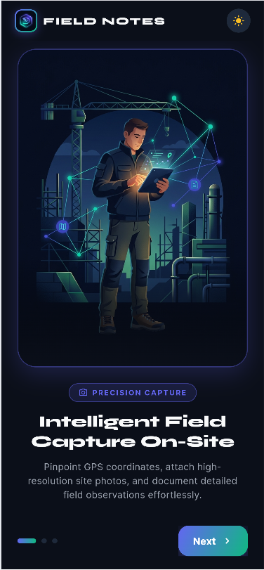 | 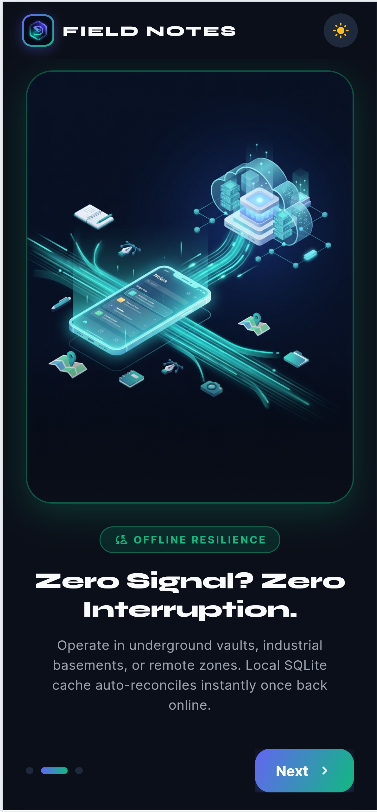 | 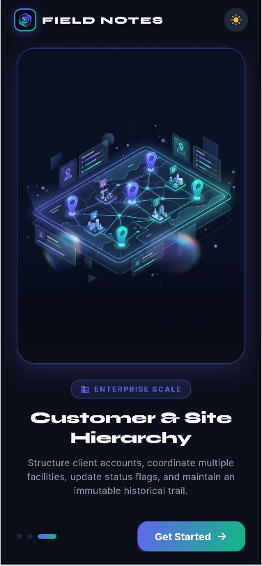 |

---

### 🔐 2. Authentication Flow
Secure JWT-based authentication supporting state persistence and clean form validation.

| 4. Login Screen | 5. Registration Screen |
| :---: | :---: |
| 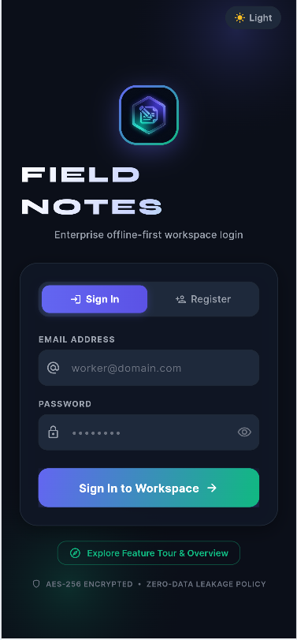 | 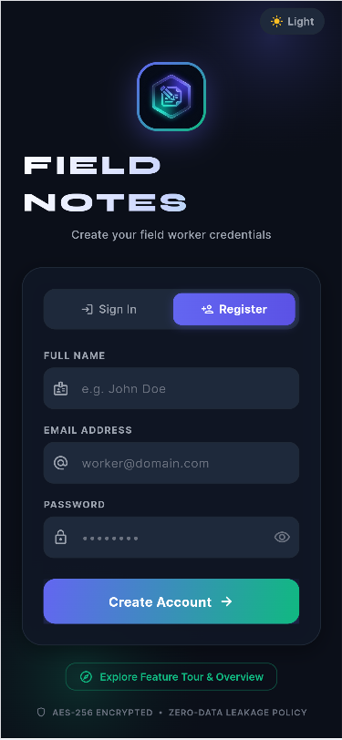 |

---

### 📋 3. Dashboard & Field Notes
Real-time dashboard metrics, filterable inspection records, and rich field note creation with GPS & photo attachments.

| 6. Executive Dashboard | 7. Field Notes List & Search | 8. Add Field Note Form |
| :---: | :---: | :---: |
| 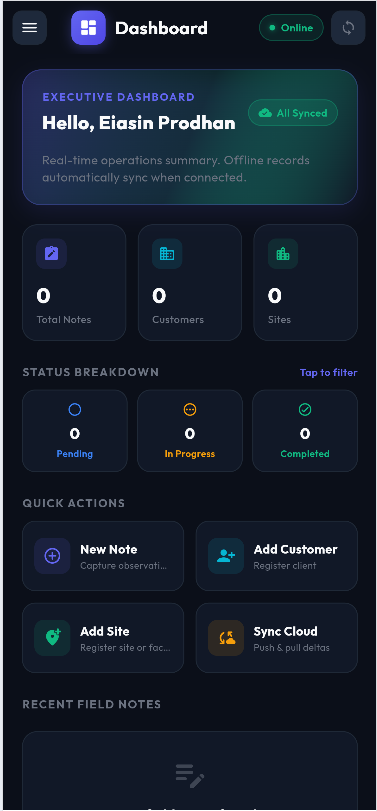 | 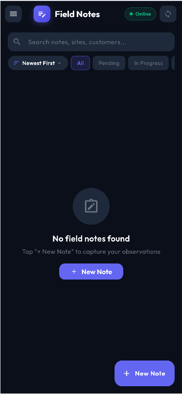 | 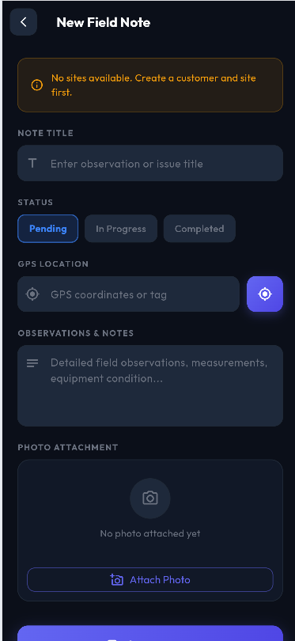 |

---

### 🏢 4. Customers & Site Management
Comprehensive directory management with relational linking between customers, facilities, and notes.

| 9. Customers Directory | 10. Add Customer | 11. Sites Directory | 12. Add Site |
| :---: | :---: | :---: | :---: |
| 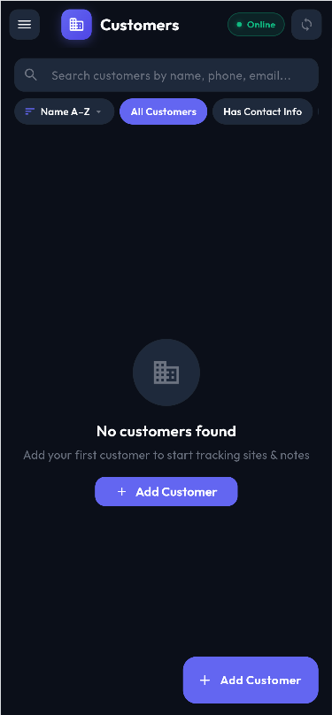 | 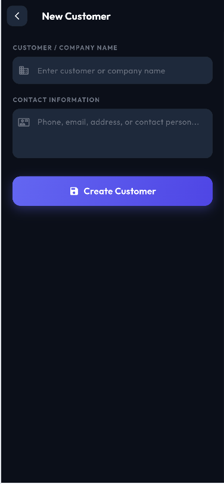 | 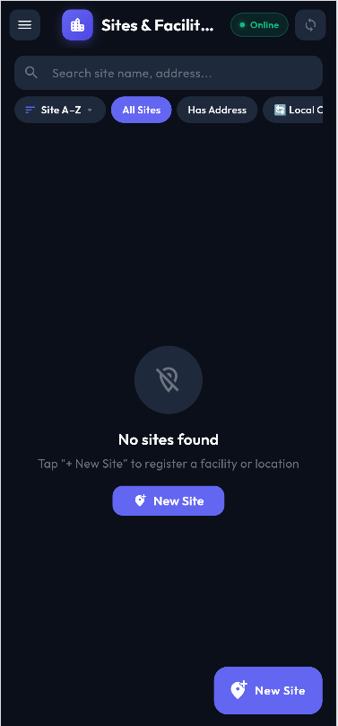 | 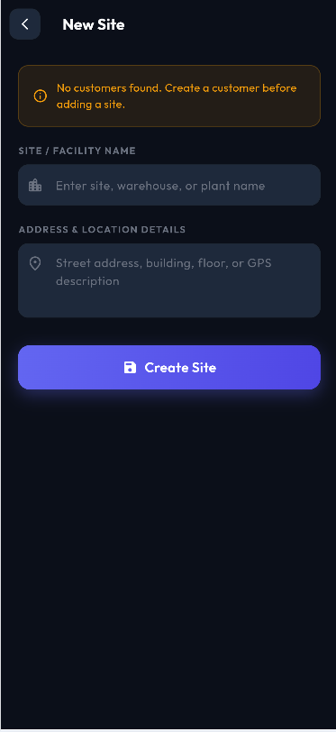 |

---

### ⚙️ 5. User Profile, Settings & Sync Center
Worker profile management, offline defaults configuration, custom server endpoint switcher, and real-time synchronization diagnostics.

| 13. User Profile | 14. Settings & Preferences | 15. Sync Center & Diagnostics |
| :---: | :---: | :---: |
| 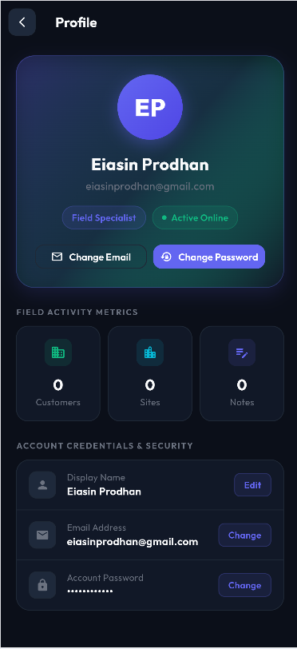 | 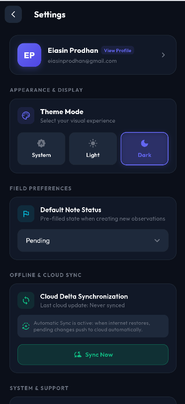 | 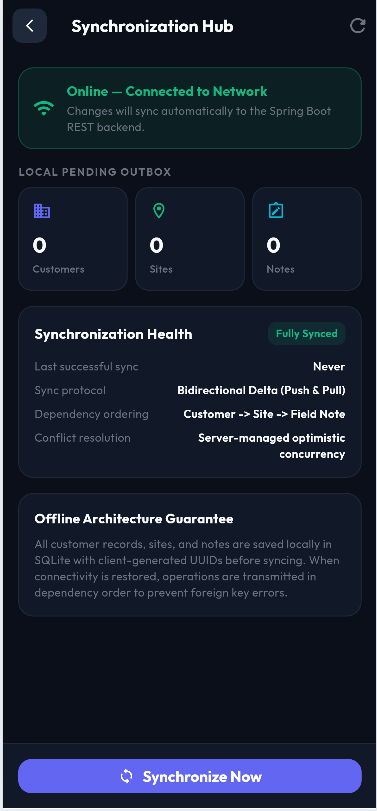 |

---

## 🚀 Key Highlights & Capabilities

- 📶 **100% Offline-First Architecture**: All reads and writes execute against a local SQLite database first. Field workers experience zero UI lag and never lose progress due to connection drops.
- 🔄 **Smart Bi-Directional Delta Sync**:
  - Automatically identifies local dirty rows (`sync_pending = 1`) and batches them via `POST /api/sync/push`.
  - Fetches server updates using timestamp cursors via `GET /api/sync/pull?since=<instant>`.
  - Conflict resolution implemented using server-aligned **Last-Write-Wins (LWW)** on `updatedAt`.
  - Automatic sync triggers on login, manual pull-to-refresh, and dynamic connectivity restoration.
- 📍 **GPS Geolocation & Media Capture**: Automatic location fetching with accuracy checks and camera/gallery photo uploads with preview.
- 🔍 **Real-Time Client-Side Search**: Fast fuzzy search across notes, titles, descriptions, and linked customer/site names completely offline.
- 🌐 **Cross-Platform Compatibility**: Full support for Android, iOS, Web (via `sqflite_common_ffi_web`), Windows, macOS, and Linux.
- 🎨 **Modern Design System**: Clean typography with Google Fonts Inter, refined dark/light glassmorphic UI elements, and intuitive status badges.

---

## 🛠 Tech Stack

| Category | Technologies / Packages |
| :--- | :--- |
| **Framework** | Flutter 3.19+ / Dart 3.3+ |
| **State Management** | `flutter_bloc` (v8.1.6) with `equatable` |
| **Local Database** | `sqflite`, `sqflite_common_ffi`, `sqflite_common_ffi_web` |
| **Networking & API** | `dio` (v5.4.3) with JWT Interceptors |
| **Hardware & Devices** | `geolocator`, `image_picker`, `permission_handler` |
| **Network Detection** | `connectivity_plus` (v6.0.5) |
| **Local Settings** | `shared_preferences` |
| **Typography & UI** | `google_fonts` (Inter) |

---

## 📂 Project Architecture

```
lib/
├── main.dart                  # Dependency injection & database bootstrap
├── app.dart                   # MultiBlocProvider, global themes, and auth routing
├── core/
│   ├── constants.dart         # API endpoints & SharedPreferences keys
│   ├── network/               # Dio HTTP client, JWT auth interceptor, token storage
│   ├── storage/               # Local preferences (default status, last sync timestamp)
│   └── theme/                 # AppColors, color schemes, and theme definitions
├── models/                    # Data models: Customer, Site, FieldNote, NoteStatus, Sync DTOs
├── data/
│   ├── local/
│   │   └── app_database.dart  # SQLite schema, offline CRUD, dirty flags & soft deletes
│   ├── remote/
│   │   └── api_client.dart    # REST API endpoints (auth, CRUD, photo upload, sync)
│   └── repositories/
│       ├── auth_repository.dart    # Token storage, login, registration, session state
│       └── field_repository.dart   # Offline-first repository orchestrating DB & Sync
├── bloc/                      # BLoCs: Auth, Customer, Site, Note, Sync, Settings, Connectivity
└── presentation/
    ├── screens/               # Screen widgets (onboarding, auth, home, notes, sites, settings)
    └── utils/                 # Permission helpers (camera, storage, GPS)
```

---

## ⚡ Running Process (Step-by-Step)

### 1. Prerequisites
- **Flutter SDK**: `^3.19.0` or higher ([Install Flutter](https://docs.flutter.dev/get-started/install))
- **Dart SDK**: `^3.3.0`
- **Backend Service**: Ensure the Spring Boot backend (`field-notes-springboot-mysql`) is running.

---

### 2. Configure Backend API Endpoint
The default base URL is defined in `lib/core/constants.dart`:
```dart
class ApiConstants {
  static const String baseUrl = 'http://127.0.0.1:8080';
  // ...
}
```

Depending on your target device, configure the appropriate endpoint:

| Target Platform | Endpoint to Use | Notes |
| :--- | :--- | :--- |
| **Chrome / Web** | `http://127.0.0.1:8080` | Localhost loopback |
| **Android Emulator** | `http://10.0.2.2:8080` | Android loopback alias to host machine |
| **iOS Simulator** | `http://127.0.0.1:8080` | Shares Mac localhost network |
| **Physical Phone** | `http://<YOUR_LAN_IP>:8080` | e.g. `http://192.168.1.15:8080` (ensure device is on same Wi-Fi) |

> 💡 **Tip:** You can also dynamically update the API base URL directly from the in-app **Settings Screen** without modifying code!

---

### 3. Install Dependencies
In the `field-notes-flutter` directory, run:
```bash
flutter pub get
```

---

### 4. Verify Code Quality & Static Analysis
Run static analysis to confirm no issues exist:
```bash
flutter analyze
```

---

### 5. Launch the Application

#### A. Run on Chrome (Web)
```bash
flutter run -d chrome
```

#### B. Run on Android (Emulator or Connected Device)
```bash
# List available devices
flutter devices

# Run on Android
flutter run -d android
```

#### C. Run on iOS (Simulator)
```bash
flutter run -d ios
```

#### D. Run on Desktop (Windows / macOS / Linux)
```bash
flutter run -d windows
```

---

## 🔄 Offline Synchronization Protocol

1. **Local Mutation**:
   Every creation, edit, or deletion is applied immediately to the local SQLite database. The record is flagged with `sync_pending = 1` and stamped with a client-side UTC `updatedAt` and UUID.
2. **Push Phase (`POST /api/sync/push`)**:
   When sync is initiated (manually or upon network reconnect), all records where `sync_pending == 1` are bundled into a single atomic payload and dispatched to the server.
3. **Pull Phase (`GET /api/sync/pull?since=<timestamp>`)**:
   The client requests all remote updates committed since the last recorded sync instant.
4. **Conflict Resolution**:
   Records are merged by `uuid`. If both local and server records were modified, the record with the newer `updatedAt` timestamp prevails (**Last-Write-Wins**).
5. **Fresh Installation / Disaster Recovery**:
   When logging in on a new device, a full pull (`GET /api/sync/pull` without `since`) rebuilds the complete local SQLite database state.

---

## 🔒 Platform Permissions

### Android (`android/app/src/main/AndroidManifest.xml`)
The following permissions are configured:
- `android.permission.INTERNET` — Network communications with backend
- `android.permission.ACCESS_FINE_LOCATION` & `ACCESS_COARSE_LOCATION` — Geotagging field notes
- `android.permission.CAMERA` — Capturing inspection photos
- `android.permission.READ_EXTERNAL_STORAGE` / `READ_MEDIA_IMAGES` — Attaching existing gallery photos

### iOS (`ios/Runner/Info.plist`)
The following usage descriptions are configured:
- `NSLocationWhenInUseUsageDescription` — "Field Notes needs access to your location to tag field inspections."
- `NSCameraUsageDescription` — "Field Notes requires camera access to capture site condition photos."
- `NSPhotoLibraryUsageDescription` — "Field Notes requires photo library access to attach site documentation."

---

## 📦 Production Builds

```bash
# Build Android APK
flutter build apk --release

# Build Android App Bundle (Play Store)
flutter build appbundle --release

# Build Web distribution
flutter build web --release
```
